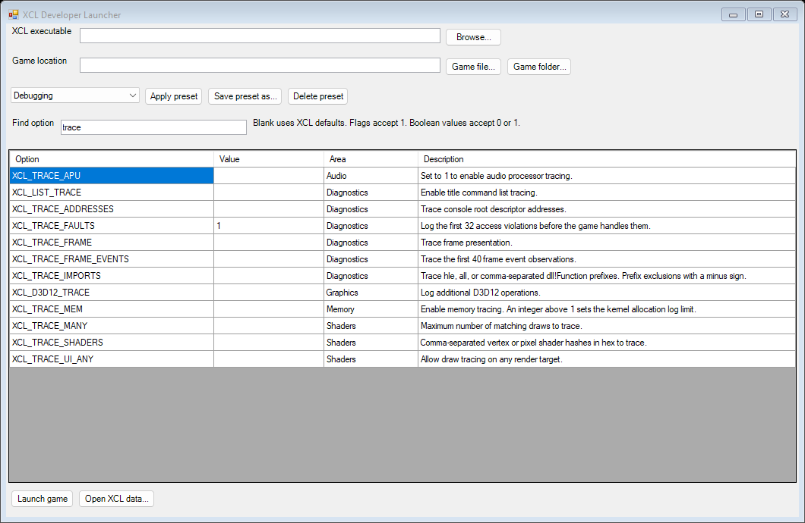

# Developer launcher

The Windows developer launcher gives you a searchable list of XCL options and saves the choices you
want to reuse. It starts the selected build with the same `xcl run` command used at the terminal.



## First launch

1. Build XCL with `cargo build --workspace --release --locked`, or have an existing Windows XCL build ready.
2. From Windows PowerShell in the checkout, run `.\scripts\xcl-launcher.ps1`.
3. Use **Browse...** to choose the XCL executable. Use **Game folder...** to choose your unpacked
   title folder, or **Game file...** for a title executable or its `MicrosoftGame.config`.
   Both location fields start blank. Use the build produced by the checkout containing the launcher
   so its available options match the list.
4. Set the options you need and select **Launch game**.

The launcher saves the locations, current values, and custom presets in
`%LOCALAPPDATA%\XCL\developer-launcher.json` when you close it or launch a title. Use
**Open XCL data...** to find the per-title `xcl.toml` and `logs` folder. If you set `XCL_DATA_ROOT`,
it opens that directory instead. XCL creates title data when it runs.

## Presets and direct launches

Choose a preset and select **Apply preset**. **Default** clears the option values. **Debugging** enables
activity and fault tracing and schedules thread stacks at 30, 60, and 120 seconds. **60-second smoke**
records activity and requests a timed offline run. To capture a stack before a specific stall, edit
`XCL_THREAD_DUMP_AT` with comma-separated elapsed seconds.

Search using an option name, area, or phrase from its description. A blank value leaves the variable
unset for XCL, `1` enables a presence flag, and a Boolean accepts `0` or `1`. **Save preset as...**
creates a named copy of the current option values. Enter an existing custom name to replace it, or
use **Delete preset** to remove it. Built-in presets stay available, and applying a preset keeps
your selected executable and game location.

Use **Debugging** with different thread dump times and launch with the remembered locations:

```powershell
.\scripts\xcl-launcher.ps1 -Launch -Preset Debugging -Options @{
    XCL_THREAD_DUMP_AT = '15,45'
    XCL_NETWORK = '0'
}
```

On first use from the command line, supply `-Xcl` and `-Game` with the paths you chose. An empty string
in `-Options` clears a stored option. Direct launches save the resolved paths and values, wait for
XCL to exit, and return its exit code.

## Maintaining it

- **Developers and agents** should use a named preset or record the equivalent command for runs that
  other contributors need to reproduce. Record the XCL commit, GPU and driver, explicitly set flags,
  and the observed result. Use the bundled test title for launcher checks. Review logs and screenshots
  before sharing them and leave personal paths and game data out of repository artifacts.
- **When adding or changing an environment option**, check the implementation first. Update
  `scripts/xcl-launcher-options.ps1` with its value format and behavior if it is useful for runtime
  launches. Leave host handoff and test-only variables internal. Keep display text and presets generic.
- **When changing the launcher**, run `.\scripts\test-launcher.ps1` in Windows PowerShell 5.1. The check
  uses a stand-in executable to verify arguments, option isolation, and settings persistence. For
  picker or layout changes, also start with fresh launcher settings, try all three browse buttons with
  blank fields, and reopen after selecting paths to verify they are remembered.
- **When updating the screenshot**, capture the actual form with a built-in preset applied. Use generic
  paths or blank fields. Keep the PNG under 1 MB in `tests/data/launcher/` so it passes the repository's
  binary-file check.
