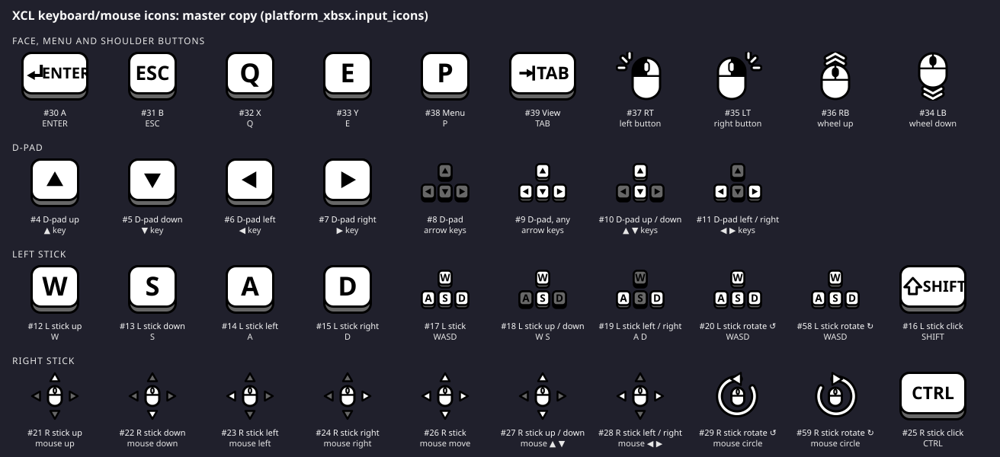

# Keyboard and mouse prompt icons (work in progress)

The newer retail title draws Xbox buttons (A, B, X, Y …) in every prompt, even when it is played with XCL's
keyboard and mouse mapping. This work replaces the title's button-icon library with keycaps and mouse
icons for the keys XCL maps to each pad button, so a prompt shows `ENTER` where it showed A.

**Status:** a first working version, not final. It runs in the title under XCL. Only the account-prompt
screen has been checked (see [Not checked yet](#not-checked-yet)). Changes and new icon sets are welcome in
the PR that introduced this folder.

Nothing here changes XCL itself. The icons reach the game through XCL's existing overlay: a patched copy
of one game archive, in the title's own XCL data folder. The game folder is never written, and no game
data is in this repository.

## Try it

Needs Windows, Python 3.10+ and `pip install fonttools`. Letters are outlined from Windows' own Bahnschrift.

```powershell
python scripts/kbm_icons/build_library.py --game D:\Game --out "$env:LOCALAPPDATA\XCL\<title folder>\overlay\data.rpf"
```

`<title folder>` is the title's folder under `%LOCALAPPDATA%\XCL` (the one with `xcl.toml`). Run the game
as usual. To undo, delete that `overlay\data.rpf`.

The tool finds the icon library in your `data.rpf` (481,544,304 bytes in the version we have), rebuilds it
from [`icons-master.svg`](icons-master.svg) and writes a full copy of `data.rpf` (about 480 MB) in which
only that entry differs. Both `--out` and the optional `--movie-out` must resolve to locations outside
the game folder.

## What the icons are



[`icons-master.svg`](icons-master.svg) is the **master copy**: one `<symbol id="Main_Button_N">` per icon
the title exports, plus a labelled sheet so the file opens as a picture. The build reads only the symbols.

| Pad input | Icon | Pad input | Icon |
|---|---|---|---|
| A | ↵ ENTER | View | ⇥ TAB |
| B | ESC | Menu | P |
| X | Q | LB / RB | mouse wheel down / up |
| Y | E | LT / RT | right / left mouse button |
| D-pad | arrow keys | L stick, L3 | W A S D, ⇧ SHIFT |
| R stick | mouse movement | R3 | CTRL |

These are the keys XCL presses each pad button with (`crates/xcl/src/hle/kbm.rs`, `gameinput.rs`).
Q, E and WASD are read by key position, so on AZERTY they are A, E and Z Q S D. One library per layout
would be needed for those.

## Evidence: the Xbox build has no keyboard/mouse icons

Checked so far with `python scripts/kbm_icons/survey.py D:\Game\data.rpf D:\Game\packs.rpf`, which reads only
and finds entries by content:

| Archive | Scaleform movies | Icon libraries | Symbols | Platform prefixes |
|---|---|---|---|---|
| `data.rpf` (481 MB) | 87 | 1: `input_icons` (28,148 bytes) | 38, `Main_Button_4…39, 58, 59`, all Xbox pad buttons | `platform_xbsx` only |
| `packs.rpf` (4.8 GB) | 0 | 0 | – | – |

- The three movies that show prompts (`generic_movie`, `hud`, `map_scripted_movie`) all load that one library.
- Every symbol is an Xbox control: A B X Y, the bumpers and triggers, Menu, View, the d-pad and the sticks.
- The icon class `InputIconV2` has a list of device prefixes (`DEVICE_PREFIXES`). This build starts it with a
  single empty entry, so there is one icon set and no second device.
- No identifier names a keyboard icon. The "mouse" names are the UI framework's cursor functions, present in
  every movie (`getMouseTopMostEntity`, `get/setMouseCursorType`), plus mouse-input functions in one movie.
  "kbm" occurs only by chance inside binary shape data, and "_key_" is a car dashboard light (`light_key_on`).
- In the game, with a keyboard reported to it through GameInput, the title reads the keyboard but keeps
  showing Xbox icons.

Not searched yet: the other archives (`anim`, `audio`, `levels`, `movies`, `navmeshes`, `common`, `script`,
`shaders`, `textures`, about 130 GB).

## How it was made

1. **Find the icon library.** The title has no keyboard or mouse icons of its own. Its only button icons are
   one Scaleform movie, `platform_xbsx.input_icons`, an entry of `data.rpf`. It holds 38 vector symbols,
   `Main_Button_4` … `Main_Button_39`, `58` and `59`, with no bitmaps. The archive's table of contents is
   encrypted, but each entry is a plain zlib stream, so the movie can be found by its content. Nothing is
   decrypted.
2. **Work out which symbol is which.** The symbols were drawn from their shape records. #30–33 are A B X Y,
   #34–37 LB LT RB RT, #38 Menu, #39 View, #4–11 the d-pad, #12–20 and #58 the left stick, #21–29 and #59
   the right stick.
3. **Measure the style.** Every symbol is 64 units square: a white plate inset 1.5, a 3-unit black outline,
   and a black legend about 25.5 units tall. Unlit parts are #676767 (the title's unlit d-pad arms).
4. **Design the keys** to the same grid (the [design system](design-system/README.md), Icon library card).
   Keys have a grey lip at the bottom edge, so a key never reads as a pad disc. Marks that sit outside a key
   are white with a black outline. A stick's directions are lit white or unlit grey, like the title's
   d-pad.
5. **Read how the title animates a prompt.** The movies that show prompts carry an ActionScript class,
   `InputIconV2`, that scales, shakes and tints the icon it places. The icons themselves don't move. The
   class's constants and per-frame tables (30 fps) give the motion below. Replacing the symbols keeps it.
6. **Measure the press colours in the game.** The engine supplies them at run time, so they were measured in
   the title under XCL by holding Y on the account prompt.
7. **Build the library** ([`scripts/kbm_icons/build_library.py`](../../scripts/kbm_icons/build_library.py)).
   It turns the master SVG into DefineShape3 records. Text becomes Bahnschrift Bold Condensed outlines,
   one shape per solid contour, because variable-font glyphs overlap. Every other tag of the title's movie
   is kept as it is. The result is packed to the original entry's exact sizes: 28,148 bytes unpacked and
   9,644 packed, at 0x117d7000.
8. **Test in the game and fix the spacing.** The title gives every icon a fixed 64-unit slot whatever its
   width. A first 112-wide ENTER ran into its PLAYER1 label, so wide keys are now 88 units, from x = −6 to 82.

## Measurements

**Press animation** (the title's `InputIconV2`, 30 frames a second; the icon scales about its point (32, 32)):

| State | What the icon does | Frames |
|---|---|---|
| Press | snaps to 80 % scale on the frame the button goes down | 0 |
| Release | back to 100 % over 0.407, 0.788, 0.918, 0.981, 1 | 5 (167 ms) |
| Hold prompt | 14 frames still, sinks to 80 % by frame 27, loops; a ring fills around it | 58 |
| Mash prompt | 1, 0.955, 0.848, 0.8, 0.851, 0.937, 0.974, 0.99, 0.998 per tap | 9 |
| Hint | 30 frames still, then the mash dip | 40 |
| Pressed while disabled | no shrink; shakes 1.5, 3, −1.6, −6, −3.3, 3.1, 7, 5.2, 3.0, 0.9, 0 units sideways | 11 |

**Colours**, measured in the game: at rest the icon is multiplied by #F9F9F9 (`COLOR_PROMPT_NEUTRAL`).
Held, #ABABAB (`COLOR_PROMPT_PRESSED`) is added: black turns #ABABAB, the plate goes to #FFFFFF, and a
keycap's grey lip clips to white, so a pressed key loses its lip. Held, the icon covers 0.62× its resting
area (0.8²). Its colours were back to rest 640 ms after release.

**Layout**, measured at a 2560×1440 window: a prompt's label ends 37 units left of the icon slot, and the
next prompt's label starts 51 units right of it. PLAYER1 to the ENTER key is 16 px (the title's A disc
sits 20 px away).

## Change the icons, and share what you change

- Change a design in [`scripts/kbm_icons/keycaps.py`](../../scripts/kbm_icons/keycaps.py) and run
  `python scripts/kbm_icons/keycaps.py` (it rewrites the master file and the Icon library preview), or edit
  `icons-master.svg` directly. The build accepts only a small SVG subset; the build script's header lists it.
- Keep to the grid: 64 tall, no wider than 88 and not left of −6. The game doesn't make room for wider
  icons. Legends, outlines and marks stay pure black and faces pure white, so the press tint shows. The
  library must pack to at most 9,644 bytes; the build stops if it doesn't.
- `python scripts/kbm_icons/motion.py` regenerates the Prompt motion preview.
- **Post your updated `icons-master.svg`** (and a picture of it) in the PR comments, so everyone can see
  each icon set side by side.

## Files

| Path | What |
|---|---|
| `icons-master.svg` | the master copy of the icons (the build's input) |
| `design-system/` | the design system: `README.md` (rules), `tokens.json`, components with guidelines and HTML previews, mouse assets |
| `scripts/kbm_icons/keycaps.py` | the icon designs; writes the master file and the Icon library preview |
| `scripts/kbm_icons/build_library.py` | builds the library into a copy of `data.rpf` |
| `scripts/kbm_icons/motion.py` | the Prompt motion preview, from the title's tables |
| `scripts/kbm_icons/survey.py` | lists the UI movies and icon libraries in an archive (the evidence above) |

The previews open in a browser. They load Barlow Condensed and Figtree from Google Fonts, which stand in
for the title's own label face.

## Not checked yet

- Every screen after the account prompt. Both runs (with and without the icons) crashed during the loading
  slides after PLAYER1, at `game+0x23cf683` (a null write), about 8½ minutes in, so the settings screens,
  the HUD and the map, which use the same library, weren't reached.
- `SHIFT`, `TAB`, `CTRL`, the mouse icons, the clusters and the hold ring around a wide key, in the game.
- Other versions of `data.rpf`. If the entry is not at the known offset the tool scans the archive for it (tested by forcing the scan on our version: 9 s), but no other version has been tried.
- Layouts other than QWERTY, and screen sizes other than a 2560×1440 window.
